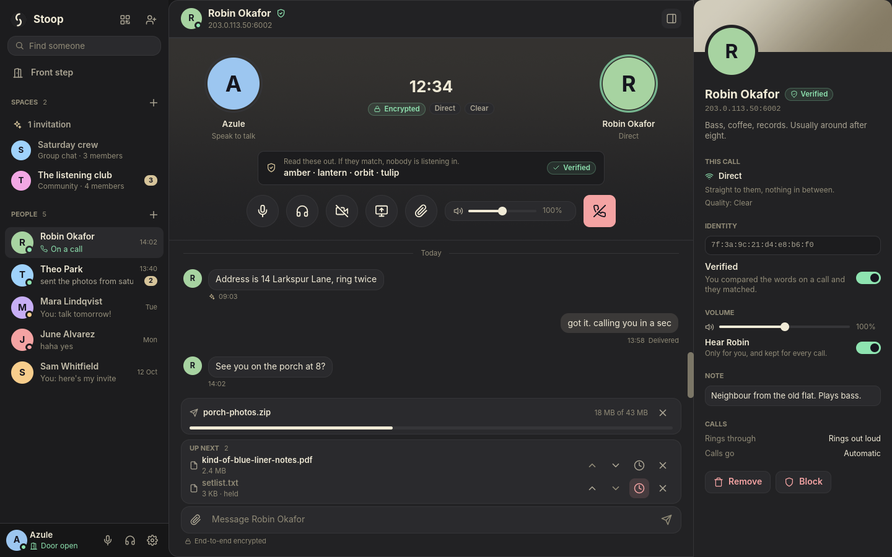

# Stoop


Stoop was called Antiphon until October 2026. The crates and binaries (`antiphon`, `antiphon-cli`, `antiphon-relay`) keep their old names for now; the app shows the new name and keeps your data in a `Stoop` folder, moved there from the old `Antiphon` one on first launch.

A direct, end-to-end encrypted voice app in Rust: two peers, no server in
the call path, a real multi-stage microphone processing chain, encrypted
text chat and file transfer over the same connection, and a native iced
interface shared by the desktop and phone apps, with a CLI alongside it.



It is a working vertical slice of the [feature spec](docs/voip-app-feature-spec.pdf),
not the whole of it. The spec describes a multi-year platform -- relays,
DHT discovery, group calls over MLS, mobile clients, VPN integration. What
is built is the part that needs no infrastructure beyond two machines that
can reach each other, built so the rest layers on without a rewrite.
**[`FEATURES.md`](FEATURES.md) is the authoritative, line-by-line status
of every item in the spec**; this file is the overview.

## What's here

A Cargo workspace, one crate per concern:

| Crate | Spec section | What it does |
|---|---|---|
| [`crates/crypto`](crates/crypto) | §3 Connection & Trust | Persistent Ed25519 identity + signed X25519 prekey, authenticated triple-DH handshake, Double Ratchet with ChaCha20-Poly1305 (fresh key per message, DH steps every few seconds, reorder-tolerant), trust-on-first-use key pinning, 40-digit verification codes, 24-word recovery phrase, cross-signed device list, OS keystore sealing (DPAPI on Windows) |
| [`crates/protocol`](crates/protocol) | §3 | Binary wire framing binding encrypted sessions to UDP datagrams (`Handshake` / `Audio` / `Control` / `File`, each with its own AAD) |
| [`crates/net`](crates/net) | §2, §3, §5, §6 | UDP peer connection, STUN discovery + hole punching, NAT-PMP port mapping with renewal, adaptive jitter buffer, forward error correction, audio retransmit requests, file chunking with per-chunk hashes |
| [`crates/audio`](crates/audio) | §1 Audio Suite | The mic chain -- noise suppression, gate, high/low-pass, de-esser, parametric EQ (bell/shelf/notch), compressor, limiter, gain/auto-gain, pitch shift with formant preservation, reverb -- plus an NLMS echo canceller with delay estimation and double-talk detection, SOLA catch-up playback, and `cpal` device I/O |
| [`crates/app`](crates/app) | §1 Utility | `antiphon-cli`: flag-driven, or an arrow-key interactive menu with no flags to memorise |
| [`crates/relay`](crates/relay) | §3 Relay, §8 mailbox | `antiphon-relay`: a self-hostable relay. Pairs two sockets on a blinded, daily-rotating token and forwards sealed frames byte for byte -- no keys, no logs, nothing kept past expiry. With `--mailbox`, also holds sealed mail for registered inboxes; with `--files`, sealed copies of pinned files; with `--dht`, a DHT node and an optional community directory; with `--federate`, peers with other relays so a call reaches someone at any relay in the mesh |
| [`crates/ui`](crates/ui) | -- | `antiphon-ui`: the Stoop interface in iced, one set of screens for the desktop and the phone. Draws a plain `Model` and hands back `Action`s, so it never touches an engine |
| [`crates/client`](crates/client) | §4, §5, §7, §8, §9, §13 | `antiphon-client`: the call engine and everything around it (contacts, history, outbox, delivery, discovery, file transfer, moderation), shared by both desktop apps |
| [`crates/desktop`](crates/desktop) | -- | `antiphon`: Stoop for the desktop, the shared interface on the client engine |
| [`crates/gui`](crates/gui) | §4, §5, §7, §8, §9, §13 | `antiphon-classic`: the previous Slint desktop app, kept while the new one catches up -- freeform call-screen layout editor, full theming, contacts with QR invites, in-call chat with history/edit/delete/reactions, streamed file transfer with resume and rate control, presence, notification rules, moderation, data export, opt-in local crash reports |

Every crate's `lib.rs` doc comment states its scope against the spec.

## Where it stands

The short version of [`FEATURES.md`](FEATURES.md):

- **Real:** the encrypted call path end to end, 1:1 or a mesh of up to
  five, direct or through a self-hosted relay, the whole §1 audio
  suite, lost-audio recovery (FEC, retransmit, adaptive jitter buffer,
  replay history, catch-up), file transfer with resume and send-rate
  control, shared files that outlive the call (per-file keys, seeding,
  pinning, multi-peer download), chat persisted encrypted at rest with
  an outbox and offline delivery through mailbox nodes on your own
  route list, contacts found again through a DHT when their address
  changes, an in-app WireGuard tunnel with per-mode routing and a kill
  switch, MLS group chats and communities with roles, threads and ban
  lists, QR / link invites, verification codes, key-change warnings, the UI editor and
  theming, presence, notification rules, data export, reproducible
  build configuration with a CI pipeline for all three desktop targets.
- **Reduced:** Caps Lock as push-to-talk works on Windows and X11 but
  not yet on macOS or Wayland; no project-run mailbox node ships as a
  default.
- **Not built yet:** voice channels inside communities, large group calls
  through an SFU (small mesh group calls are keyed with MLS and SFrame
  already), mobile clients, push notifications, packaging. Each is
  listed as such in FEATURES.md.

## Installing

Releases are on the [Releases page](https://github.com/Krifmaz/Antiphon/releases), one per
version, titled "Stoop <version>":

- **Windows:** `Stoop-<version>-windows-x86_64.exe`, an installer that needs no administrator rights.
- **Linux:** `Stoop-<version>-linux-x86_64.AppImage` or `stoop_<version>_amd64.deb`, or the plain
  binaries in `stoop-<version>-linux-x86_64.tar.gz`.
- **macOS (Apple silicon):** `Stoop-<version>-macos-aarch64.dmg`.

`SHA256SUMS` lists every file. Each release binary is built twice from a
clean tree and packaged only when both builds match byte for byte.

## Building

Rust **1.97.0** (see [`BUILDING.md`](BUILDING.md) for why the version is
stated rather than enforced, and for how to verify a release binary).

```bash
cargo build --workspace
cargo test --workspace
```

**Linux** needs the development headers the audio and UI stacks link
against:

```bash
sudo apt-get install libasound2-dev libxkbcommon-dev libfontconfig1-dev libdbus-1-dev \
    libpipewire-0.3-dev libspa-0.2-dev libgbm-dev libxcb1-dev libclang-dev
```

**Windows** builds with either the MSVC or the GNU toolchain. **macOS**
needs nothing beyond Xcode's command-line tools. The
[CI workflow](.github/workflows/ci.yml) builds and tests all three from
the same commit.

Two tests are ignored by default because they need something the test
runner may not have: `discovers_a_public_address_from_a_real_server`
(internet access and a STUN server) and `a_large_file_streams_through`
(a 64 MB transfer, run on purpose when measuring throughput):

```bash
cargo test -p antiphon large_file -- --ignored --nocapture
```

## Running it

### GUI

```bash
cargo run -p antiphon
```

Opens Stoop. First run asks for your name; an identity is generated
silently. Open your door (the switch on the front step) to take calls,
share your invite from the Invite button, and add people from theirs.
Settings -- devices, how your voice is sent, processing, theme and accent
-- apply live to a running call and persist across restarts.

**Keeping your account.** There is no server holding it, so Settings >
Account & backup is where you make sure a lost or replaced device doesn't
cost you anything:

- *Send this account to a device* shows a link and QR code; open it on
  the new computer or phone (same Wi-Fi) and it takes the whole account.
- *Back up to a file* saves identity, contacts, profile and settings
  (and history, if you like) in one `.stoopbackup` file locked with a
  passphrase. *Restore from a backup file* brings it back on any device.
- The 24-word *recovery phrase* (or Shamir shares) is the last resort: it
  restores who you are, so contacts still recognise you, but not your
  contacts list.

A restore never deletes the account it replaces; that goes into a
`replaced-<time>` folder in the app's data folder.

- `--profile <name>` keeps a separate identity and settings directory.
- `--demo` shows the interface with made-up people and a call, nothing
  on the network.
- `--screenshot-tour <dir>` walks the demo through every screen and saves
  a PNG of each (how `docs/screenshots/iced` is made).

The previous Slint app, with its layout editor, tray icon, soundboard and
the advanced panels not yet in Stoop, is still there:

```bash
cargo run -p antiphon-classic
```

### CLI

```bash
cargo run -p antiphon-cli            # interactive menu
cargo run -p antiphon-cli -- listen --port 6001
cargo run -p antiphon-cli -- call --remote <A's IP>:6001 --port 6002
```

Hold Space to talk; Ctrl+C hangs up. `--no-ptt` keeps the mic open,
`devices` lists audio devices, `preset` exports the chain as an editable
JSON file, `identity restore` recovers an identity from its 24-word
phrase.

### Relay

```bash
cargo run -p antiphon-relay -- --listen 0.0.0.0:3479
# or: docker build -f crates/relay/Dockerfile -t antiphon-relay . && docker run -p 3479:3479/udp antiphon-relay
# or the published image: docker run -p 3479:3479/udp ghcr.io/krifmaz/antiphon-relay:latest
```

Put its `host:port` in Settings > Call > Relay server. While listening,
the app registers there, and anyone without a direct route -- strangers
by default, any contact you set to Relay -- reaches you through it
without either side seeing the other's IP address. Invite links then
carry the relay too.

To also hold sealed mail for people who are offline, add `--mailbox`
(off by default). `--mailbox-code <code>` limits it to your own
community; `--mailbox-storage-mb`, `--mailbox-inbox-kb`,
`--mailbox-rate` and `--mailbox-expiry-days` set the limits, and
`--stats-every 60` prints totals. Then add its address to a route
under Settings > Call > Message delivery.

To host files people pin there, add `--files` (off by default). It
only ever holds sealed chunks it cannot read. `--files-code <code>`
limits uploads to your community; `--files-max-mb`, `--files-quota-gb`
and `--files-per-user-mb` set the limits; `--files-expire-days N` or
`--files-expire-unopened-days N` set retention (default: keep);
`--files-list` and `--files-purge <id|all>` are the admin view. Then
add its address under Settings > Call > Shared files > Pin nodes.

To be a DHT node, so contacts can find each other again after an
address changes, add `--dht` (off by default). It stores only sealed
records under keys that change daily, and can't tell whose they are.
`--dht-bootstrap <host:port>` (repeatable) joins other nodes;
`--dht-key <path>` keeps the node's key (default `antiphon-dht.key`).
`--directory <file>` also serves a directory of public communities, one
per line as `name | description | invite link`. In the app: Settings >
Call > Finding contacts -- switch the DHT on and add bootstrap nodes
(none are built in), or add a directory and press Browse.

To peer with other relays, add `--federate` (off by default) and name
one or more with `--peer <host:port>` (repeatable; `host:port#key` pins
its key, printed at its start-up). Relays then learn of each other from
their peers, each proving its key before it is used. Someone registered
at any relay in the mesh can be rung through any other: a relay that
doesn't hold the dialled token asks its peers with a hash of it, believes
only an answer that proves the peer holds it, and passes the sealed call
through. Apps also learn a relay's peers and fall back to them.
`--peer-key <path>` keeps the key (default `antiphon-peer.key`);
`--federate-max-peers`, `--federate-max-bridges` and
`--federate-allow-private` set limits.

### Test peer

`antiphon-cli echo --port 5000` is a headless peer that answers every call
and sends your audio back, so a client has someone to call without a
second person. [`docker/README.md`](docker/README.md) runs it in Docker;
the image is published as `ghcr.io/krifmaz/antiphon-echo`.

## Layout

```
crates/
  crypto/     identity, handshake, ratchet, trust, backup
  protocol/   wire framing
  net/        UDP transport, NAT traversal, recovery, file chunks
  audio/      DSP chain, echo cancellation, device I/O
  app/        antiphon-cli
  relay/      antiphon-relay, self-hostable
  client/     antiphon-client: call engine, contacts, history, delivery
  ui/         antiphon-ui: the shared iced interface (desktop + phone)
  desktop/    antiphon: Stoop for the desktop
  gui/        antiphon-classic (Slint UI) + build.rs compiling ui/app.slint
docs/         the feature spec
notes/        where work stopped, for picking up on another machine
.github/      CI: build + test on Linux/Windows/macOS; reproducible release builds
```
